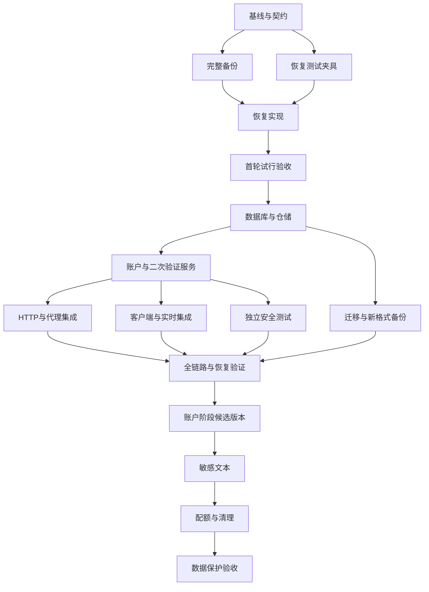

# DoNote 智能体团队模块化实施与试行计划

> 更新日期：2026-10-17（Asia/Shanghai）
> 状态：账户安全、设备设置、管理员、迁移、敏感文本加密、配额和备份恢复已接入产品；最终应用回归 116/116、静态检查、备份恢复 28 项及真实 Chrome 敏感生命周期与双标签页撤销均通过；Node 24 目标镜像验收通过。目标镜像验收不等于生产部署或真实用户数据迁移。详见[最终验证记录](final-release-validation.md)、[容器验收记录](container-acceptance.md)和[配额接线说明](donote-quota-integration.md)。
> 设计依据：[多用户与数据保护设计](donote-multiuser-data-protection.md)。
> 本次范围：提供分工、任务依赖、接口约定、试行步骤和验收门槛；不自动创建团队或部署。

## 1. 交付目标与执行原则

将现有密码式剪贴板升级为管理员受控的多用户系统，交付账户隔离、可撤销会话、TOTP 严格登录、设备管理、登录记录、敏感操作再次验证，以及可恢复的数据迁移。后续再交付敏感文本加密和配额。

团队执行时优先参考本计划的契约、依赖、写入边界和验收条件；若它与架构方案的历史描述冲突，先暂停实现，由组长更新两份文档后再继续。

首轮团队试行只验证“独立测试数据的备份与恢复”。试行成功后再开展账户安全改造，不能将未完成的认证模块直接接入生产。

执行约束：

- 保留当前工作区未提交的前端和测试改动。启动时记录基线，不执行 reset、clean 或批量格式化。
- 每项任务有唯一负责人、写入范围、依赖、输入契约、验收和交接记录。
- 同一文件只允许一个负责人写入。其他成员提交接口要求或修改建议，由文件负责人落实。
- 任务完成不等于可以发布；组长负责审查最终差异、集成和验证，发布需满足阶段门槛。
- 开发测试使用隔离目录、测试账户和随机端口，不读取生产密码或修改真实数据。
- 设计冲突先更新契约，不能让各模块各自兼容一种协议。
- **前端不改现有样式**：只增加新功能必须的入口、表单、状态和交互；复用现有视觉系统，不重做品牌、配色、字体、间距、布局或既有组件外观。局部新增样式必须有功能必要性且不影响既有页面。

## 2. 推荐团队配置

建议从组长加 4 名成员开始。角色是职责分配，不要求每个角色永久占用一个智能体；同一成员可以按阶段顺序承担不同模块。

| 角色 | 建议名称 | 职责 | 固定写入边界 |
| --- | --- | --- | --- |
| 组长与集成 | lead | 契约、任务排序、跨模块集成、最终审查与发布门槛 | 现有应用入口、统一配置、依赖锁、部署和 CI 集成 |
| 数据与运维 | data-ops | 数据库仓储、备份恢复、初始化和迁移 | 新增数据层目录、版本迁移、运维脚本；按轮次执行 |
| 认证与安全 | auth-security | 密码、session、TOTP、操作授权、恢复与管理员服务 | 新增安全服务和自身路由模块 |
| 客户端与实时 | client-realtime | 登录与设备界面、客户端清理、Socket 会话失效 | 前端和 Socket；大改动分轮执行 |
| 验证与审查 | verifier | 独立测试、越权/并发/恢复验证、审查证据 | 独立测试文件和测试夹具；默认不修改产品代码 |

如果增加第 6 人，可把 Socket 与代理集成从客户端角色拆出，但现有应用入口仍由组长单独集成。不建议起步就让多个成员同时编辑前端主文件。

## 3. 文件所有权与冲突处理

以下既有文件存在较高冲突风险，先指定唯一写入人：

| 文件 | 默认负责人 | 其他模块如何协作 |
| --- | --- | --- |
| [config.js](../app/src/config.js)、[app.js](../app/src/app.js)、[server.js](../app/server.js)、[路由入口](../app/src/routes/index.js) | lead | 提交新增配置、初始化顺序和挂载要求 |
| [package.json](../app/package.json)、[依赖锁](../app/package-lock.json)、[Dockerfile](../app/Dockerfile)、[CI](../.github/workflows/check.yml) | lead | 成员提出精确依赖与环境要求，由组长统一安装和构建 |
| [前端主文件](../app/public/app.js)、[页面](../app/public/index.html)、[样式](../app/public/style.css)、[Service Worker](../app/public/service-worker.js) | client-realtime | 安全模块提供接口和状态契约；统一更新缓存版本 |
| [socket.js](../app/src/socket.js) | client-realtime | auth-security 提供 session 查询与撤销事件契约 |
| [认证中间件](../app/src/middleware/auth.js)、[认证路由](../app/src/routes/auth.js)、[限流](../app/src/middleware/rateLimit.js) | auth-security | 挂载顺序由组长处理 |
| [storage.js](../app/src/storage.js)、[message.js](../app/src/message.js)、[文件路由](../app/src/routes/files.js)、[upload.js](../app/src/upload.js)、[cleanup.js](../app/src/cleanup.js) | lead，阶段 C 可整组转交一个负责人 | 不允许加密与配额成员同时修改；按依赖顺序集成 |
| [backup.sh](../scripts/backup.sh)、[restore.sh](../scripts/restore.sh)及新增迁移脚本 | data-ops | verifier 只改对应测试 |
| [Nginx 主配置](../nginx/conf.d/20-clipboard.conf)、[共享配置](../nginx/conf.d/00-shared.conf)、[Compose](../docker-compose.yml) | lead | 接收认证与实时模块的变更要求 |
| [现有路由测试](../app/test/routes.test.js)、[多用户测试](../app/test/multi-user.test.js) | verifier | 模块成员可以新增自己独占的单元测试文件 |

新目录如 `app/src/security/`、`app/src/db/` 是拟建位置，正式创建前在契约任务中固定。数据库 schema 及所有迁移文件统一由 data-ops 写入；auth-security 不自行创建第二套表结构。

需要转交文件时，原负责人先停止编辑并提交交接说明，组长更新任务范围，再由新负责人开始。共享目录或任务板的写入范围只是协作约定，不是文件锁。

## 4. 开工前必须固定的契约

任务 C00 由组长主持，相关成员审阅后再开始依赖任务。契约记录到一个版本化实施说明中，不只放在聊天消息里。

| 契约 | 必须明确的内容 |
| --- | --- |
| 身份上下文 | `userId`、`sessionId`、角色、安全版本、认证强度；只能由服务端构造 |
| 账户仓储 | 创建、查找、状态变更、最后管理员保护及事务边界 |
| session 服务 | 创建、校验、撤销单个/其他/全部、过期、账户安全版本检查 |
| 登录状态机 | 密码通过→待 TOTP→完整 session；绑定因素与首次登录强制改密的受限状态 |
| 操作授权 | 单次、短期、绑定 session/动作/目标/安全版本；与撤销事务一致消费 |
| 错误响应 | 401 未登录、403 无权、404 跨用户资源、409 状态冲突、429 限流；稳定错误码 |
| 浏览器协议 | HttpOnly Cookie、CSRF 获取与提交、`/me` 初始化、401 与撤销统一清理 |
| 实时事件 | session 撤销/到期、账户失效、私有状态清空；事件负载不含 token |
| 数据格式 | SQLite 迁移版本、JSON 兼容、用户目录 UUID 映射、备份 manifest |
| 运行环境 | 受支持 Node LTS、SQLite/Argon2 原生依赖、目标 CPU、容器构建方式 |

`/api/auth/reauth` 的返回不是完整登录 token。TOTP 验证接口也不直接替代通用安全操作授权。所有有效期和阈值由服务端配置，客户端计时仅用于展示。

## 5. 模块任务清单

任务依赖表示“依赖通过验收后才开始依赖它的实现”。契约确认后可先做静态界面或测试夹具，但不得将 mock 当作集成完成。

### 5.1 准备与数据基础

| ID | 模块 / 负责人 | 依赖 | 交付与验收 |
| --- | --- | --- | --- |
| C00 | 基线与契约 / lead | 无 | 记录已有改动、测试结果、文件所有权、契约和风险；明确隔离测试目录 |
| O01 | 完整备份 / data-ops | C00 | 覆盖根目录旧数据与全部 users；归档清单、权限、失败传播；不静默遗漏必需文件 |
| V01 | 备份恢复夹具 / verifier | C00 | 单用户、多用户、中文文件名、空目录、损坏和逃逸归档；只生成合成数据 |
| O02 | 安全恢复 / data-ops | O01、V01 | 暂存校验、回滚点失败中止、恢复完整性；旧格式兼容有明确规则 |
| D01 | 数据库基础 / data-ops | 首轮试行通过 | schema 版本、仓储事务、外键、WAL、安全配置；原生依赖由 lead 安装构建 |
| D02 | 账户/session/审计仓储 / data-ops | D01、C00 | 按已固定契约交付；最后管理员事务保护；token 不存明文；完整测试 |
| O03 | 初始化与迁移 / data-ops | D02、O02 | 安全密码输入、旧用户到 UUID 映射、dry-run、幂等与校验、源数据保留 |
| O04 | 新格式备份恢复 / data-ops | O03 | SQLite、JSON、附件一致快照；恢复撤销 session；版本和密钥需求校验 |

### 5.2 账户与安全服务

| ID | 模块 / 负责人 | 依赖 | 交付与验收 |
| --- | --- | --- | --- |
| S01 | 密码与 session / auth-security | D02 | Argon2id、随机 Cookie、期限与撤销；HTTP 请求不再接受旧密码鉴权 |
| S02 | TOTP 与登录挑战 / auth-security | S01 | 待验证挑战无业务访问权、TOTP 重放防护、绑定确认、恢复码哈希及单次消费 |
| S03 | 操作级再次验证 / auth-security | S02 | 2 分钟内单次授权，绑定动作和目标；只持有 Cookie 无法踢出其他设备 |
| S04 | 账号与管理员管理 / auth-security | S03 | 创建/启停/重置/角色与恢复；管理员第二因素；最后管理员保护；审计 |
| S05 | 登录历史与在线摘要 / auth-security | S01、D02 | 登录和安全事件、脱敏 IP、保留期；有效会话与在线状态分开 |
| I01 | HTTP 与代理集成 / lead | S01、S02、S03、S04、S05 | CSRF、Origin、可信代理、组合限流、认证路由例外、no-store；无旧凭据回退 |

### 5.3 客户端、实时与验证

| ID | 模块 / 负责人 | 依赖 | 交付与验收 |
| --- | --- | --- | --- |
| F01 | 登录与安全界面 / client-realtime | C00；真实集成依赖 S02、S03 | 用户名登录、TOTP、恢复码、受限初始化、安全设置；不写密码/token 到 localStorage |
| F02 | 设备与登录历史界面 / client-realtime | F01、S03、S05 | 当前设备、在线/有效数量、单设备/其他/全部撤销、操作前再次验证 |
| R01 | Socket 会话集成 / client-realtime | F02、S01、S03 | Cookie 握手、Origin 准入、session 索引、到期/撤销断开；当前设备不误踢 |
| F03 | 残留清理 / client-realtime | R01 | 退出/401/撤销/账户切换清理；多标签页同步，旧异步响应丢弃，缓存版本升级 |
| V02 | 安全服务验证 / verifier | S01、S02、S03 | Cookie 劫持、挑战重放、跨用户目标、授权并发消费与过期、因子恢复失效 |
| V03 | 全链路验证 / verifier | I01、F03、S04、S05、O04 | HTTP/附件/Socket 越权、代理真实入口、设备撤销、浏览器残留、恢复演练 |
| G01 | 账户阶段发布候选 / lead | V02、V03、O03 | 最终差异、全套检查、目标镜像构建、迁移演练、回滚证据；形成候选版本 |

同一 client-realtime 成员顺序完成 F01→F02→R01→F03。若独立增加实时成员，应先将 R01 文件范围正式转交，不能两人同时修改前端和 Socket 集成代码。

### 5.4 数据保护后续模块

| ID | 模块 / 建议负责人 | 依赖 | 交付与验收 |
| --- | --- | --- | --- |
| E01 | 敏感文本与密钥 / auth-security | G01 | 正文+备注加密、AAD、keyId、短期解锁、轮换；序列化不泄露敏感内容 |
| E02 | 敏感文本集成 / lead + client-realtime，各自独占文件 | E01 | JSON 兼容、列表/搜索/Socket 占位、内存短时展示、导出和复制规则 |
| Q01 | 配额与上传清理 / data-ops，先转交存储文件所有权 | E02 | multipart/Data URL 全覆盖、并发预留或串行化、失败清理及对账 |
| V04 | 数据保护验收 / verifier | E02、Q01 | 篡改密文、错密钥、缓存泄露、并发超额、断连清理、历史密钥恢复 |
| G02 | 数据保护发布候选 / lead | V04 | 全量回归、备份恢复和轮换演练 |

WebAuthn、附件加密、定向共享另行建立任务，不混入本轮试行，也不因名称相似复用敏感文本解锁授权。

## 6. 并行安排与依赖图



可并行的工作：O01 与 V01；仓储完成后的安全服务与迁移工具；安全服务稳定后代理集成、客户端实现及独立服务测试。顺序执行的工作：同一文件的多个改动、schema 迁移、依赖安装、格式化、数据库生成和最终集成。

组长不能把依赖未完成的任务标成可执行来提高表面并发量。成员等待依赖时，可补测试设计或审阅契约，不自行复制依赖实现。

## 7. 第一轮小范围试行

### 7.1 试行范围

参与者：lead、data-ops、verifier。auth-security 和 client-realtime 可以只阅读设计，无需同时启动执行。

执行 C00、O01、V01、O02，目标是在隔离数据上证明团队能完成一次有依赖的交付。产品认证、前端和生产部署均不在该轮修改范围。

### 7.2 执行步骤

1. lead 记录当前改动与检查结果，指定两名成员的任务及互不重叠的写范围。
2. data-ops 阅读备份/恢复实现，列出旧格式兼容规则后实现 O01；verifier 同时创建 V01 合成夹具与验收用例。
3. 两方交接归档 manifest、目录规则和错误码；契约冲突由 lead 决定并记录。
4. V01 完成后 data-ops 执行 O02；verifier 从用户恢复目标独立检查，不只核对实现分支。
5. lead 审查差异，在隔离目录执行单用户/多用户往返恢复、失败注入及现有检查。
6. 输出试行结论、遗留项、实际文件冲突和下一轮调整；通过后才分派 D01。

### 7.3 试行通过条件

- 全部用户的消息、原图、缩略图和附件往返一致，中文文件名正常。
- 损坏归档、逃逸路径、危险链接和必需文件缺失被拒绝。
- 回滚点建立失败时不覆盖目标数据，恢复失败有明确结果。
- 测试没有触碰真实数据、密码或线上容器。
- 组长能复现成员报告的命令与结果，没有依赖未提交的隐式状态。
- 原有用户改动保留；任务分工未出现未经交接的文件重叠。

试行未通过时修复原任务，不扩大到账户改造。试行不是生产备份恢复操作，也不以线上恢复作为验收手段。

## 8. 可直接使用的成员任务模板

```text
任务 ID / 标题：
负责人：
设计依据：docs/donote-multiuser-data-protection.md 的对应章节
必须先读：相关代码与已确认契约
依赖任务及验收结果：
允许修改的目录/文件：
禁止修改的共享文件：
输入接口与数据格式：
应交付的接口/文件/行为：
安全不变量：
验收用例及失败场景：
测试环境：隔离目录、测试凭据、随机端口
交接内容：改动摘要、测试命令与结果、兼容性、风险、需组长集成的变更
完成标准：实现完成 + 对应检查通过 + 交接记录；最终集成验收由组长决定
```

成员起步提示词：

```text
你负责上述唯一任务。先阅读现有文件，再执行。不要覆盖已有用户改动。
仅修改分配范围；需要改共享文件时将精确变更要求发给组长。
依赖未通过时报告阻塞，不复制其他成员的实现，不自行扩大任务。
安全关键行为以设计契约和后端校验为准，不能用前端约束代替。
前端保留现有样式和布局，只补新增功能；复用现有样式，禁止顺带美化或视觉重设计。
结束前运行相关检查，报告实际结果、未覆盖项和交接事项。
不要提交、发布、部署或访问真实生产数据，除非组长已有明确任务授权。
```

## 9. 共享任务板与交接规则

团队创建后，再将本文件任务导入任务板；本文件中的 ID 是计划编号，不是已经创建的工具任务 ID。

- 建立任务时填写依赖和写范围；成员领取前读取最新任务版本。
- 状态按 pending → in_progress → completed 更新；遇到新契约或失效依赖时重新打开。
- 修改前声明预计范围；交接时列出实际修改文件和所需集成。
- 后台进程、构建和测试由启动人记录 job ID，完成时收集输出，失去用途时停止。
- 等待结果不代表任务完成；成员空闲不代表交付已验收。
- 组长先审查成员结果，再运行适当的集成检查；不能只凭成员“已完成”发布。
- 发现安全问题时记录可复现步骤、影响、修复归属和重新验收结果，不通过降低测试要求来完成任务。

## 10. 阶段完成与发布门槛

每个阶段都提供：任务结果表、最终差异、已执行命令、失败修复、未覆盖范围、迁移/回滚证据。

基础检查沿用：

```bash
npm --prefix app run check
npm --prefix app test
./scripts/check.sh
```

新增测试按模块执行；浏览器行为必须有浏览器回归，Nginx 来源和 Cookie 行为必须通过实际代理入口测试，原生依赖必须通过目标镜像构建。不能只用直接访问 Express 的单元测试代替这些验证。

发布门槛：

1. 设计中的 P0 缺口关闭，账户阶段的 TOTP、操作授权和设备管理不能延后到发布之后。
2. 独立验证覆盖越权、撤销、重放、并发与浏览器残留。
3. 完整迁移和恢复在隔离环境演练成功，所有必需密钥可恢复。
4. 不存在旧密码与新 session 混用的鉴权回退。
5. 当前前端改动与新增安全界面一起验收，缓存版本同步；对比既有页面确认未改动现有样式和布局。
6. 发布候选版本和运维说明完成后，再按实际授权决定是否部署；本计划本身不执行生产变更。

完成账户阶段后再评估团队规模与模块划分。若串行依赖占主导，减少同时运行的成员；若测试和前端持续成为瓶颈，再基于明确文件边界增加成员。
